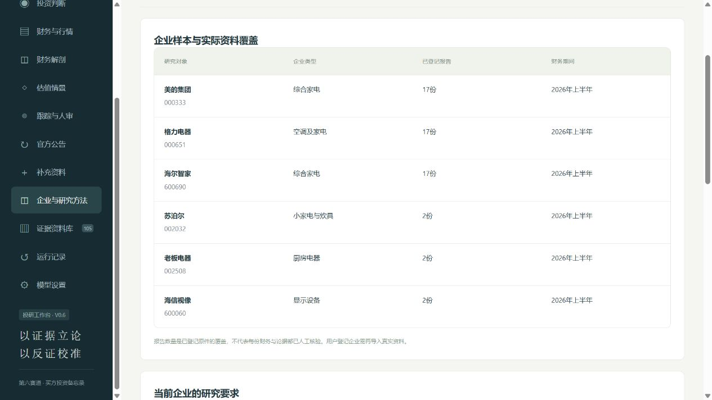

# ThesisLens · 知衡

2026年10月14日机房反馈补充：用户提交的另一电脑主要功能及模型流程实测已完成；完整测试142通过/2项缺pypdf报错，新PDF导入未测。金融签认、计划书及视频仍待完成。见[机房验收补充](知衡初版/V0.7机房验收补充.json)。下文旧版本验收为历史记录。

**融合证据链与反向验证的买方投研智能体**  
以证据立论，以反证校准。

面向大学生金融人工智能竞赛第六赛道“买方投资备忘录编制”。系统把公司披露、行业政策与行情组织为可追溯的研究证据，连接财务分析、估值假设、研究写作、反向复核和持续跟踪。

当前 **V0.7**：保留美的集团、格力电器、海尔智家，加入苏泊尔、老板电器、海信视像，覆盖综合家电、小家电与炊具、厨房电器和显示设备。基础资料截至2026年10月6日，可在本机补充新资料。企业研究要求进入规划、检索、模型上下文和导出；海外经营压力情景按有原页的收入与成本复算毛利，独立于PE盈利。新三家深度原页与日线已补齐，金额附注优先取回并记录状态。研究要求为开发侧建议，待金融同学确认。



本次实现、测试和演示建议见[V0.7技术补完与交接](参赛交付/V0.7技术补完与交接.md)。计划书和演示视频由用户制作，原V0.5材料保留为历史草稿，本次程序体验包不混入旧计划书与视频。第三方来源与许可见[NOTICE](NOTICE.md)。

## 快速运行

需要Python 3.10或以上、SQLite FTS5。前端无需安装依赖，核心使用Python标准库；导入新的PDF需可选组件。

1. 克隆或下载仓库，保留两个中文文件夹的相对位置。
2. Windows双击 `知衡初版/启动知衡.cmd`；其他系统运行 `python3 知衡初版/launch.py`。
3. 自动打开本机工作台，默认端口8765；被占用时选择空闲端口。首次启动自动建立索引。
4. 先使用“资料模式”，再在“模型设置”配置自己的服务并测试连接。

可选PDF组件：`python -m pip install -r 知衡初版/requirements-optional.txt`。

默认读取 `DEEPSEEK_API_KEY` 使用DeepSeek。界面提供阿里云百炼预设，也支持其他Chat Completions兼容服务。临时密钥只保留在服务进程内存中。已真实验证DeepSeek完整流程；百炼需使用自己的账号测试。

## 可操作的功能

- **检索增强**：多路关键词召回、问题改写和模型语义重排；保留排序理由、检索记录和降级提示。尚未使用向量索引。
- **企业与研究方法**：六家真实样本及报告覆盖；按细分业务显示研究重点与输入要求。用户可登记其他企业并导入真实原文；非上市企业按资料研究处理，不套用上市公司PE或交易约束。
- **官方公告**：六家内置企业配置了巨潮或上交所查询，按日期、公司、关键词筛选，选取至多5份导入。新增企业的持续公告查询能力不等于已经收集其全部公告；仍保留范围与失败提示。
- **资料与增量证据**：中文检索、公司/期间/披露日期过滤、PDF物理页码与网页位置回看；补充文字、PDF、HTML或允许域名的官方网址，支持暂停与重新启用。
- **历年财务与同行比较**：57份财报；原三家各17个期间，新增三家各覆盖2025全年和2026半年。四项累计流量保留调整后基期、提取状态、公式与逐项页码；参考企业跨细分业务时不自动构成估值可比公司组。
- **财务解剖**：登记三家公司2025年报和2026半年报的合并资产负债、购建长期资产现金支出、产品/地区收入、股数；恒等式、合计与原页检查。未登记或修订的报告不会套用旧表。
- **论据关联**：T编号将投资论据与风险、失效条件、跟踪指标连接，引用以E编号回看原页；结构有效仍需核对证据支持。
- **估值情景**：原值计算TTM盈利，谨慎/基准/乐观PE；可选用户输入的FCFE折现与敏感性分析，可将假设附带到研究。
- **海外经营压力**：美的与苏泊尔2026半年报登记了海外收入、成本及物理原页。用户设置收入变化与毛利率变化百分点，复算海外收入和毛利；缺基数的企业不借用其他公司的数字，不将毛利变化直接映射归母利润或PE。
- **投资判断**：登记投资目标、用户假设的观察期限、可选投入上限和损失约束；按论据、估值及人工核验状态整理判断、回报情景、进入研究候选和退出复核条件。证据不齐时明确暂缓判断。
- **估值依据与参考PE**：记录三档倍数的来源、期间及选择理由，人工复核声明单独保存；采用保存日期的A股报价和所选股数计算参考PE。股利与费用未明确输入时只显示价格空间，不假装总回报已齐。
- **简略/详细备忘录**：同一份研究切换展示与导出，简版保留重大风险、规则检查及资料缺口；JSON始终保存完整记录。旧案例的补充判断标明历史视图，不改写原模型输出。
- **智能体编排**：拆解问题、分主题检索、确定性计算、研究写作、反向复核；中高风险时最多修订一轮并再次复核。
- **研究追问**：同一时点继续检索和回答，独立引用编号，保留多轮上下文与调用记录。
- **跟踪与人工核验**：财务/价格阈值按本机最新数据提示复核，逐条登记支持依据或反证，查看结构与可追溯性检查分。
- **复现与答辩**：恢复历史研究，记录计划、工具检索、公式、提示词、模型输出和用量；Markdown/JSON/HTML导出，打印页面可存为PDF。

## 资料与质量

基础包与扩展包合计102个公开来源、76份PDF共8,440页、23项行业及政策网页、原三家3,069条日线。扩展资料分开保存在`07_扩展企业`并由`知衡初版/company_sources.json`接入，保留官方查询、披露日期和文件摘要。新增企业未收集行情，也尚未登记完整财务解剖原页；页面显示缺口。原件权利归各自发布方，引用时保留出处。

V0.2查出并更正4份历史财报披露日期登记错误。应用层叠加更正，保留原始PDF字节、旧日期和核验网址，见[日期更正记录](知衡初版/source_overrides.json)。旧研究保留当时快照，涉及这4份报告应重新生成。

57份报告的四项指标均已提取，其中7份使用人工登记并复算，其余为规则提取。**规则通过不等于人工审核通过。** 不同复核提示词使用同一模型服务；引用支持、表头归属和因果仍需人工检查。结构分不代表事实正确率。

估值倍数、FCFE与股数是用户假设。系统不由EPS反推期末股本，不把经营现金流直接替代FCFE。跟踪按本机已有数据计算，新资料需导入；当前没有无人值守的自动新闻推送。

参考PE使用期末或输入股数口径，并非行情商的官方当前PE；A/H/D股份不共用报价，不能用A股报价乘总发行股数认定真实公司总市值。情景回报不等于观察期限内的收益预测，股利期间、情景兑现时间和税务影响仍需核验。勾选倍数已复核只代表用户本人声明。

口径规则检查捕获应收期末对期初增幅与营收同比的直接混比，以及未经量化桥接便从汇兑分类解释推出核心盈利稳定。本次另补两条有限规则：不同单位、基期的“隐含趋势”不可作比较阈值；反证不能撤回正文没有提出的稳定判断。规则意见进入已有的一轮修订流程，修订后仍有实质问题时阻断投资判断；规则不是通用事实正确性证明。

## 验证与说明

运行自动检查（V0.6全套136项通过）：

```bash
python -m unittest discover -s 知衡初版 -p "test_*.py" -v
```

启动后检查HTTP、引用和导出（不发起模型调用）：

```bash
python 知衡初版/check_http.py
```

V0.6流程验收：`python 知衡初版/check_v06.py --base-url http://127.0.0.1:8765`。真实模型复测加`--live`，仅一个苏泊尔公开资料案例，最多5次成功调用；测试结果写入本机`data/`。保存的真实案例965d0992d2f6完成5次成功调用，剩余1中、6低模型意见，判断暂缓，没有金融签认。恢复该案例使用`python 知衡初版/demo_case.py --restore --version v06`，不调用模型。历史默认恢复仍保留V0.5。

V0.4固定开发题集扩大至20题：一次真实模型验收中，关键词Hit@5为14/20、增强检索为19/20，MRR@5为0.4542与0.8458。17题实际语义排序，3题格式异常降级，1题始终漏检。选题与标注由开发者完成，非独立盲测；页面命中不代表结论事实正确率。实际记录见[V0.4验收记录](知衡初版/V0.4验收记录.json)。V0.3小样本记录保留为历史版本。

V0.4历史模型完整案例保存6次成功调用、25项证据和11个步骤，耗时44.55秒；当时排序格式异常已显示降级。修订后仍保留1项高、4项中、3项低级复核意见，未作专家签认。失败请求可能产生费用，成功调用日志数不是服务商账单次数。

新电脑查看本次V0.5公开历史案例，先安装可选PDF组件，再运行`python 知衡初版/demo_case.py --restore`；查看旧V0.4案例则加`--version v04`。在运行记录打开相应历史示范。恢复不调用模型，原运行时间和编号另外保留。示范目录仅包含选定公开数据，不包含本机全部运行库或密钥。

查看开发侧逻辑修订示例，可运行`python 知衡初版/demo_case.py --restore --version v05_logic`。它由eb64fcc72e43派生，明确记录改动；不是新增模型生成结果或金融专家签认。默认恢复仍选择原V0.5真实历史记录。

操作与接口见[使用说明](知衡初版/README.md)，阶段状态见[功能进度](知衡初版/功能进度.md)，实现见[技术报告](参赛交付/技术报告.md)。本机密钥、索引、核验备注、数据库和常规运行历史均不上传；选定的公开历史示范单独登记。下载后配置自己的研究环境。

## V0.5本次收尾状态（2026-10-12）

此前114项回归及14项离线示范恢复检查通过。干净安装副本另完成91项较早的接口检查（3家公司、5个不同问题、无模型或外网请求），属于同机验证；这些历史数量不冒充本次逻辑补强的新验收。

首次V0.5真实模型记录c30a0bb56179及8项开发复查保留。默认公开示范恢复补强后的eb64fcc72e43：7次成功调用、53.53秒、29项证据；模型原稿未人工润色，判断保持暂缓。规则与提示词补强后的真实模型复测已完成（eb64fcc72e43），保留2项中、3项低模型复核意见和待金融复审事项。

参赛PDF与文档已更新V0.5并补齐团队署名。视频由团队自行制作；金融签认、另一台实体电脑/团队模型账号验收及独立未知题盲测仍待完成。详情见`参赛交付/README.md`及`知衡初版/V0.5验收记录.json`。

## 本次逻辑补强与金融待核验

T2分别观察同基期应收同比与相应期间营收同比、周转天数与上年同期间；缺少基准时只列核验事项，不用53.16%期初增幅的“隐含趋势”代替。原T3的管理层分类解释与利润桥缺口移入待核实事项；原T4重编号T3，仅讨论经营现金流/归母利润比值不低于1的未来假设及对应反证，不扩张成整体现金回收稳健。

另纠正账龄占比“继续抬升”的预设与财务收入负号措辞。原真实案例、模型复核与开发审查均保留；`demo/case_logic_v05.json`单独标为开发侧逻辑修订。本次128项回归和14项原稿离线恢复检查通过，无模型/网络调用；原稿现有2项中风险规则意见，派生示例0项但仍暂缓、无人审。PE依据、利润桥与金融人工核验仍待完成。复审要点见[逻辑修订与金融核验要点](参赛交付/逻辑修订与金融核验要点.md)。
