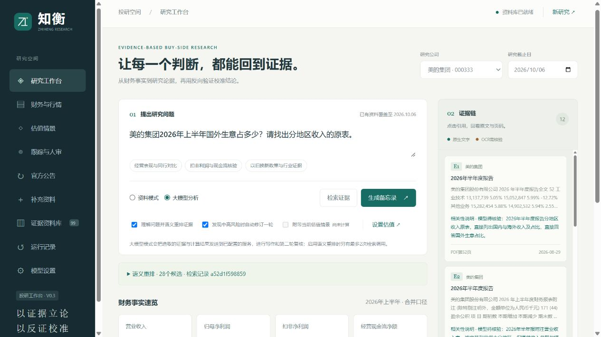

# ThesisLens · 知衡

**融合证据链与反向验证的买方投研智能体**  
以证据立论，以反证校准。

面向大学生金融人工智能竞赛第六赛道“买方投资备忘录编制”。系统把公司披露、行业政策与行情组织为可追溯的研究证据，连接财务分析、估值假设、研究写作、反向复核和持续跟踪。

当前 **V0.4**：以美的集团为主案例，格力电器、海尔智家为同行对照。基础资料截至2026年10月6日，可在本机补充新资料。新增财务解剖、论据与反证关联、可恢复真实模型示范和参赛材料。



计划书、答辩手册及3分30秒字幕MP4见[参赛交付](参赛交付/README.md)。封面身份信息暂留待填写；演示保留历史模型复核问题，尚未向主办方提交。

## 快速运行

需要Python 3.10或以上、SQLite FTS5。前端无需安装依赖，核心使用Python标准库；导入新的PDF需可选组件。

1. 克隆或下载仓库，保留两个中文文件夹的相对位置。
2. Windows双击 `知衡初版/启动知衡.cmd`；其他系统运行 `python3 知衡初版/launch.py`。
3. 自动打开本机工作台，默认端口8765；被占用时选择空闲端口。首次启动自动建立索引。
4. 先使用“资料模式”，再在“模型设置”配置自己的服务并测试连接。

可选PDF组件：`python -m pip install -r 知衡初版/requirements-optional.txt`。

默认读取 `DEEPSEEK_API_KEY` 使用DeepSeek。界面提供阿里云百炼预设，也支持其他Chat Completions兼容服务。临时密钥只保留在服务进程内存中。已真实验证DeepSeek完整流程；百炼需使用自己的账号测试。

## 可操作的功能

- **检索增强**：多路关键词召回、问题改写和模型语义重排；保留排序理由、检索记录和降级提示。尚未使用向量索引。
- **官方公告**：检查巨潮资讯与上交所的三家公司公告，按日期、公司、关键词筛选，选取至多5份导入。保留列表来源与披露日期；上交所原件不可读取时，严格核对巨潮同公司、同日、同名原件。
- **资料与增量证据**：中文检索、公司/期间/披露日期过滤、PDF物理页码与网页位置回看；补充文字、PDF、HTML或允许域名的官方网址，支持暂停与重新启用。
- **历年财务与同行比较**：51份财报、17个期间的四项流量；区分全年、半年、一季度和前三季度累计，保留调整后基期、提取状态、公式和逐项页码；趋势图与CSV。
- **财务解剖**：登记三家公司2025年报和2026半年报的合并资产负债、购建长期资产现金支出、产品/地区收入、股数；恒等式、合计与原页检查。未登记或修订的报告不会套用旧表。
- **论据关联**：T编号将投资论据与风险、失效条件、跟踪指标连接，引用以E编号回看原页；结构有效仍需核对证据支持。
- **估值情景**：原值计算TTM盈利，谨慎/基准/乐观PE；可选用户输入的FCFE折现与敏感性分析，可将假设附带到研究。
- **智能体编排**：拆解问题、分主题检索、确定性计算、研究写作、反向复核；中高风险时最多修订一轮并再次复核。
- **研究追问**：同一时点继续检索和回答，独立引用编号，保留多轮上下文与调用记录。
- **跟踪与人工核验**：财务/价格阈值按本机最新数据提示复核，逐条登记支持依据或反证，查看结构与可追溯性检查分。
- **复现与答辩**：恢复历史研究，记录计划、工具检索、公式、提示词、模型输出和用量；Markdown/JSON/HTML导出，打印页面可存为PDF。

## 资料与质量

基础包包含96个公开来源、70份PDF共7,425页、23项行业及政策网页、3,069条日线和7,855个检索片段，约199MB。原件权利归各自发布方，引用时保留出处。详见[资料包说明](知衡数据资料/家电行业_截至2026-10-06/README.md)。

V0.2查出并更正4份历史财报披露日期登记错误。应用层叠加更正，保留原始PDF字节、旧日期和核验网址，见[日期更正记录](知衡初版/source_overrides.json)。旧研究保留当时快照，涉及这4份报告应重新生成。

51份报告的四项指标均已提取，其中7份使用人工登记并复算，其余为规则提取。**规则通过不等于人工审核通过。** 不同复核提示词使用同一模型服务；引用支持、表头归属和因果仍需人工检查。结构分不代表事实正确率。

估值倍数、FCFE与股数是用户假设。系统不由EPS反推期末股本，不把经营现金流直接替代FCFE。跟踪按本机已有数据计算，新资料需导入；当前没有无人值守的自动新闻推送。

## 验证与说明

运行52项自动检查：

```bash
python -m unittest discover -s 知衡初版 -p "test_*.py" -v
```

启动后检查HTTP、引用和导出（不发起模型调用）：

```bash
python 知衡初版/check_http.py
```

V0.4固定开发题集扩大至20题：一次真实模型验收中，关键词Hit@5为14/20、增强检索为19/20，MRR@5为0.4542与0.8458。17题实际语义排序，3题格式异常降级，1题始终漏检。选题与标注由开发者完成，非独立盲测；页面命中不代表结论事实正确率。实际记录见[V0.4验收记录](知衡初版/V0.4验收记录.json)。V0.3小样本记录保留为历史版本。

真实模型完整案例保存6次成功调用、25项证据和11个步骤，耗时44.55秒；本次排序格式异常已显示降级。修订后仍保留1项高、4项中、3项低级复核意见，未作专家签认。失败请求可能产生费用，成功调用日志数不是服务商账单次数。

要在新电脑查看这个公开历史案例，先安装可选PDF组件，再运行`python 知衡初版/demo_case.py --restore`，打开“运行记录”的“历史大模型示范 · 保存记录”。恢复不调用模型，原运行时间和编号另外保留。示范目录仅包含选定公开数据，不包含本机全部运行库或密钥。

操作与接口见[使用说明](知衡初版/README.md)，阶段状态见[功能进度](知衡初版/功能进度.md)，实现见[技术报告](参赛交付/技术报告.md)。本机密钥、索引、核验备注、数据库和常规运行历史均不上传；选定的公开历史示范单独登记。下载后配置自己的研究环境。
