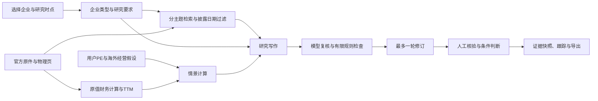

# 知衡 V0.6：程序升级与交接

日期：2026年10月14日。本次修改智能体、公开样本、使用说明及验收记录。项目计划书和演示视频由用户制作，原V0.5计划书与PDF保持原文件，本次程序体验包不包含它们。

## 已落实的修改

1. **样本由3家扩展为6家。** 保留美的、格力、海尔，加入苏泊尔（小家电与炊具）、老板电器（厨房电器）、海信视像（显示设备）。新增每家2025年报、2026半年报，共6份官方原件、1,015页。原三家各17份财报，新三家各2份；合计57份财报、102基础来源、8,440页PDF。四项累计流量和TTM均使用本企业原件、报告基期、单位与物理页码。
2. **研究要求进入实际编排。** 综合家电、小家电、厨电和显示设备分别提示业务结构、渠道、关联交易、工程回款、面板与海外等研究重点，送入问题规划、专项检索、写作与复核；研究快照及导出保留要求与数据覆盖。参考公司跨细分业务时不自动等同估值可比组。
3. **增加海外毛利压力情景。** 美的2026半年报物理第52页、苏泊尔物理第12页的海外收入和成本已登记，绑定原件摘要。用户输入收入变化%与毛利率变化百分点，复算同期间收入、毛利及毛利变化。零变化与原收入减成本精确一致，不用显示舍入后的毛利率回算。缺基数的企业或期间明确不可计算；毛利变化不等于归母利润、汇兑损益或PE变化。
4. **非上市企业可以登记并导入资料。** 系统生成资料研究编号，拒绝伪造证券代码；本企业原文缺失时拒绝借用行业材料生成企业研究。当前不套用上市公司归母、公开交易报价、PE与交易约束。合成测试材料只验证流程，不计为真实样本。
5. **保持旧案例与新案例的身份。** 原金融反馈与原模型记录继续保留，新要求不反向冒充旧案例已完成；本次苏泊尔真实模型案例单独保存并可离线恢复。

## 技术路线

海外压力只进入风险讨论及独立毛利计算，不自动调整TTM盈利。资料模式不调用模型；非上市分支只整理业务与资料缺口。

## 已验证的内容

- **136项自动检查通过**：新增原件摘要、时点、同比/TTM自身来源、企业方法差异、非上市登记、压力输入、零变化和修订原件冲突等检查，并通过原有回归。
- **54项本机流程检查通过**：三家新企业及美的的资料研究、需求快照、毛利基数原页、Markdown/HTML简详导出与完整JSON；无模型调用。
- **24项真实模型流程检查通过**：苏泊尔新案例965d0992d2f6，5次成功调用（规划、写作、复核、修订、再次复核），19条证据。模型剩余意见为1项中、6项低；有限规则未发现新增项，判断仍为暂缓。通过是流程验收，不是事实准确率、专家签认或投资效果验证。
- **19项非上市合成流程检查通过**：在同机干净源码副本中登记合成企业、拒绝缺原文的企业研究、导入合成业务材料、输出资料研究及导出，并拒绝上市PE。该副本还离线恢复新真实模型案例，原件与海外基数可回看，全程无新模型或公网请求；合成企业不计入真实样本。
- 原模型输入、输出、首次与修订后意见保留于`知衡初版/demo/case_model_v06.json`。恢复命令为`python 知衡初版/demo_case.py --restore --version v06`，不发起模型请求。默认历史恢复仍保留V0.5选择。

更多验收、干净安装和封包记录见程序的`V0.6验收记录.json`及体验包旁的`交付封包验收.json`。

## 录制演示可采用的流程

1. 打开“企业与研究方法”，展示六家企业及真实报告数量，选择苏泊尔或老板电器说明研究重点不同。
2. 展示新增企业2026半年报四项财务事实与TTM，点击原页回看日期、单位和基期。
3. 选择苏泊尔，在“估值情景”填写自己的PE倍数；展开海外压力输入，演示收入-10%、毛利率-1个百分点，明确是演示假设。
4. 附带情景生成研究，或恢复已保存的真实模型案例；展示专项检索、E引用、T论据、剩余复核与暂缓判断。
5. 展示研究要求、数据缺口、人工核验入口及导出，说明金融同学仍可补充支持关系，而非只看程序分数。

## 仍需补充与实际边界

- **金融同学有必要参与最终复审**：确认按企业类型拆分的研究需求，核对引用是否支持经营判断、利润归因、关联交易口径、估值依据和剩余模型意见。本次规范来自开发侧，没有替他们签认。
- 新三家仅有两期主要财报；完整深度登记、行情历史及更多公司公告尚未补齐。原文可检索不代表所有字段已经结构化。当前海外量化基数覆盖两家，不宣称建立全球宏观预测模型。
- 非上市企业入口可用，但未把合成材料包装成真实非上市样本。可取得可引用的真实业务或财务资料后再扩展。
- 没有实际投资收益回测、独立未知题盲测或另一台实体电脑验证；同机干净安装验证与这些事项分开。
- 用户的计划书需自行解释背景、意义、模型选择、预期成果、样本选择理由及局限，并加入图表。可以引用本文件的已实现功能和验收证据，不能写成所有教师建议、金融审核及投资有效性均已完成。
